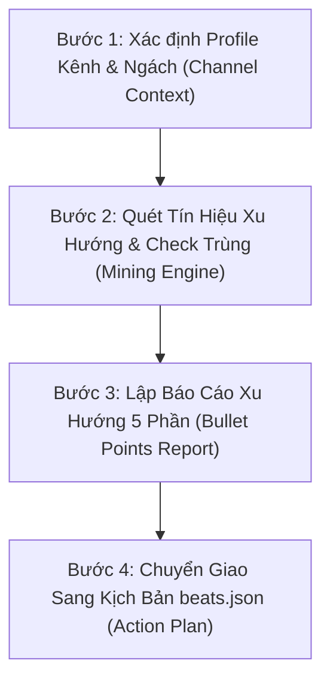

# YouTube Trend Scout — Chuyên Gia Đào Ý Tưởng & Xu Hướng YouTube Faceless

Skill này đóng vai trò là **Chuyên Gia Nghiên Cứu Xu Hướng YouTube Độc Lập**, chuyên săn lùng các chủ đề ngách bùng nổ (high-retention / explosive content) cho các kênh **YouTube Faceless** (đặc biệt là thị trường Mỹ/Quốc tế), dựa trên dữ liệu thực tế từ Reddit, YouTube search signals và phân tích đối thủ.

> ⚠️ **THAM CHIẾU HỆ THỐNG WORKFLOW:**
> - [`.agents/rules/video-production.md`](file:///d:/video-atlas/.agents/rules/video-production.md) — 17 quy tắc sản xuất kỹ thuật
> - [`.agents/rules/channel-identities.md`](file:///d:/video-atlas/.agents/rules/channel-identities.md) — Tham số các kênh hiện có (`Papercut Business`, `Pixel Rewind`, `Pulp Hypotheses`)
> - Khi chọn được chủ đề ➔ Kích hoạt ngay [`reddit-research`](file:///d:/video-atlas/.agents/skills/reddit_research/SKILL.md) và [`human-scriptwriter`](file:///d:/video-atlas/.agents/skills/human_scriptwriter/SKILL.md) để xuất kịch bản `beats.json`.

---

## 🧭 Quy Trình 4 Bước Đào Ý Tưởng (Step-by-Step Discovery)

---

### Bước 1: Thu Thập & Xác Định Profile Kênh

AI Agent kiểm tra xem yêu cầu thuộc về một **kênh đã có trong hệ thống** hay là một **ngách mới hoàn toàn**:

#### 1. Nếu thuộc kênh có sẵn trong hệ thống (`Papercut Business`, `Pixel Rewind`, `Pulp Hypotheses`):
- Tự động nạp thông tin Persona, Niche, và Subreddits mục tiêu từ Skill của kênh đó.
- Bỏ qua bước phỏng vấn, đi thẳng vào Bước 2.

#### 2. Nếu là ngách mới / kênh mới chưa có profile:
AI Agent yêu cầu hoặc xác nhận nhanh 5 thông số cốt lõi:
- **YouTube Niche (Ngách nội dung):** [Ngách cụ thể, ví dụ: Tài chính ngầm, Bí ẩn công nghệ cổ điển, Giả thuyết lịch sử, Tâm lý học tội phạm...]
- **Target Audience (Khán giả mục tiêu):** [Độ tuổi, quốc gia, sở thích, ví dụ: Nam 20-40 tuổi tại Mỹ, thích tài liệu mini/explainer]
- **Primary Goal (Mục tiêu chính):** [Kéo view viral cho Short, tăng Subscriber chất lượng, hay đẩy RPM kiếm tiền AdSense]
- **Available Resources (Tài nguyên sẵn có):** [AI Visual Generator (FlowKit / Google Flow), 24 FPS Assembly Engine, TTS Voice]
- **Biggest Challenge (Thách thức lớn nhất):** [Bị dìm view do nội dung AI chung chung, thiếu góc nhìn người thật, cạnh tranh cao...]

---

### Bước 2: Quét Tín Hiệu Xu Hướng & Kiểm Tra Trùng Lặp

1. **Kiểm tra kho video đã làm trong `out/`:**
   - Quét danh sách thư mục dự án trong `out/` để đảm bảo **KHÔNG đề xuất lại** các chủ đề đã sản xuất.
2. **Khai thác dữ liệu Reddit (qua `reddit_research` MCP):**
   - Quét các Subreddit Tier 1 & Tier 2 theo ngách để tìm các bài post có `score > 2000` hoặc nhiều tranh luận nảy lửa.
3. **Bộ lọc 5 Tiêu Chí Bùng Nổ:**
   - ✅ **Độ quen thuộc cao (Familiarity):** 80%+ khán giả mục tiêu đã biết sản phẩm/nhân vật/sự kiện này.
   - ✅ **Góc nhìn khuất / Nghịch lý (Contradiction/Mystery):** Có sự thật trái ngược trực giác ("tại sao rẻ", "tại sao bị cấm", "khoản lỗ tỷ đô").
   - ✅ **Kích hoạt cảm xúc mạnh (Emotion Trigger):** Gây bức xúc nhẹ, kinh ngạc tột độ, hoặc hoài niệm sâu sắc.
   - ✅ **Data/Con số cụ thể:** Có dữ kiện đắt giá làm Hook 3 giây đầu.
   - ✅ **Visual Potential:** Minh họa xuất sắc bằng phong cách hình ảnh của kênh (Paper Collage, Pixel Art, hoặc Retro Comic).

---

### Bước 3: Xuất Báo Cáo Xu Hướng Chuẩn (Standard Output Format)

Báo cáo PHẢI được trình bày mạch lạc bằng **danh sách gạch đầu dòng (Bullet Points)** theo đúng cấu trúc chuẩn sau:

---

## 📋 BÁO CÁO PHÂN TÍCH XU HƯỚNG & Ý TƯỞNG BÙNG NỔ

### 1. 🔥 5 Chủ Đề Ngách Đang Thịnh Hành (Trending Niche Topics)

*   **Chủ đề 1: [Tên Chủ Đề Tiếng Anh / Tiếng Việt]**
    *   **Hook 3s gợi ý:** *"..."* (Câu mở đầu đấm thẳng vào nghịch lý/con số).
    *   **Góc nhìn độc bản (Unique Angle):** [Điểm khác biệt so với các video phổ thông trên mạng].
    *   **Tiềm năng View (Estimated View Potential):** [Ví dụ: 100K – 500K views / Rất cao do đang viral trên Reddit].
    *   **Lý do bùng nổ (Viral Trigger):** [Tại sao khán giả Mỹ sẽ click và giữ chân xem hết].

*(Lặp lại tương tự cho Chủ đề 2, 3, 4, 5)*

---

### 2. 🏷️ 10 Từ Khóa Tìm Kiếm Cao (High-Search Keywords)

*   `[Keyword 1]` — **Search Intent:** [Mục đích tìm kiếm] | **Độ cạnh tranh:** Thấp/Trung bình | **Vị trí tối ưu:** Title & First 2 Lines.
*   `[Keyword 2]` — **Search Intent:** [Mục đích tìm kiếm] | **Độ cạnh tranh:** Thấp/Trung bình | **Vị trí tối ưu:** Headline.
*   `[Keyword 3]` — ...
*(Đủ 10 từ khóa phân cấp từ Broad Niche đến Long-tail cụ thể)*

---

### 3. 🕵️ Phân Tích Đối Thủ Đầu Ngành (Top Competitor Breakdown)

*   **Đối thủ 1: [Tên Kênh / Video Tiêu Biểu]**
    *   **Điểm mạnh:** [Cách họ làm thumbnail, pacing, retention].
    *   **Lỗ hổng nội dung (Content Gap):** [Họ bỏ sót chi tiết nào mà ta có thể đào sâu hơn].
    *   **Chiến lược vượt mặt (Beat Strategy):** [Cách kênh của ta làm hay hơn bằng phong cách visual độc bản & góc nhìn Reddit].
*   **Đối thủ 2: [Tên Kênh / Video Tiêu Biểu]**
    *   **Điểm mạnh:** ...
    *   **Lỗ hổng nội dung:** ...
    *   **Chiến lược vượt mặt:** ...

---

### 4. 🎬 5 Format Video Triển Khai Ngay Trong Tuần (Proven Video Formats)

*   **Format 1: The "Hidden Monopoly / Dark Secret" (Bí mật độc quyền)**
    *   *Thời lượng phù hợp:* Short 53-58s hoặc Long-form 3-5 phút.
    *   *Cấu trúc:* Phơi bày 1 sản phẩm bình dân quen thuộc nhưng do 1 tập đoàn thâu tóm với giá cắt cổ.
*   **Format 2: The "Why It Failed / Discontinued" (Tại sao sụp đổ)**
    *   *Thời lượng phù hợp:* Long-form 4-5 phút.
    *   *Cấu trúc:* Narrative arc `man_in_hole` — một cỗ máy/công ty tiềm năng bị khai tử do 1 sai lầm ngớ ngẩn.
*   **Format 3: The "What If Alternative History" (Giả thuyết lịch sử nghịch lý)**
    *   *Thời lượng phù hợp:* Short 50-55s.
    *   *Cấu trúc:* Lật ngược 1 sự kiện lịch sử quen thuộc bằng 1 chi tiết công nghệ/quân sự kỳ lạ.
*   **Format 4: The "Banned & Law Loophole" (Chiêu trò lách luật)**
    *   *Thời lượng phù hợp:* Short 55s hoặc Long-form 3 phút.
    *   *Cấu trúc:* Giải thích tại sao một điều kỳ quặc lại hợp pháp (hoặc bị cấm) trên toàn nước Mỹ.
*   **Format 5: The "One Engineer / Creator Story" (Câu chuyện 1 cá nhân)**
    *   *Thời lượng phù hợp:* Long-form 3-4 phút.
    *   *Cấu trúc:* Đưa 1 nhân vật ít người biết làm trung tâm của một phát minh thay đổi thế giới.

---

### 5. 🚀 Action Plan: Triển Khai Ngay (Next Steps)

*   [ ] Chọn 1 trong 5 chủ đề trên để tiến hành sản xuất.
*   [ ] Kích hoạt `reddit_research` để quét các thread và top comments thực tế.
*   [ ] Kích hoạt `human_scriptwriter` để sinh kịch bản `beats.json` (có cột dịch tiếng Việt ở Gate 1).
*   [ ] Gửi user duyệt kịch bản và xuất bản video.

---

## 💡 Hướng Dẫn Kích Hoạt Nhanh

User chỉ cần gõ các lệnh ngắn gọn:
- *"Đào cho tôi 5 ý tưởng bùng nổ cho kênh Papercut Business tuần này"*
- *"Nghiên cứu xu hướng ngách [Tên ngách] cho kênh Faceless"*
- *"Phân tích đối thủ và tìm từ khóa tiềm năng cho chủ đề [Chủ đề]"*
- *"Gợi ý video tiếp theo kèm format triển khai ngay"*
