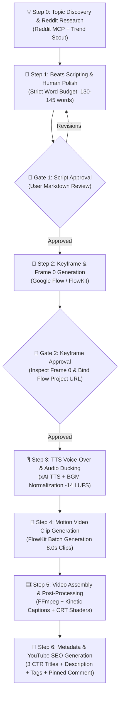

# 🎬 Video Atlas — Autonomous Multi-Channel AI Video Production Pipeline

[English](README.md) | [Tiếng Việt](README.vi.md)

[](https://www.python.org/)
[](https://opensource.org/licenses/MIT)
[](#)
[%20%7C%20Long--form%20(16:9)-red)](#)

> **Video Atlas** is a production-grade, autonomous pipeline designed to generate broadcast-quality videos for faceless YouTube channels targeting US and global audiences. By orchestrating specialized AI Agents, Google Flow (via the FlowKit browser bridge), xAI TTS, and local FFmpeg rendering, Video Atlas transforms a single raw topic into fully produced videos—complete with human-quality narration, visual pacing, dynamic kinetic captions, sound design, and full YouTube SEO metadata.

---

## 📑 Table of Contents
- [🌟 Key Highlights](#-key-highlights)
- [🏛️ Multi-Channel Brand Architecture](#️-multi-channel-brand-architecture)
- [⚙️ End-to-End Pipeline Workflow](#️-end-to-end-pipeline-workflow)
- [📂 Repository Architecture](#-repository-architecture)
- [🚀 Prerequisites & Installation](#-prerequisites--installation)
- [🛠️ Quickstart CLI Walkthrough](#️-quickstart-cli-walkthrough)
- [🛡️ Production Guardrails & Quality Standards](#️-production-guardrails--quality-standards)
- [📊 Distribution & Growth Funnel](#-distribution--growth-funnel)
- [🤝 Contributing & License](#-contributing--license)

---

## 🌟 Key Highlights

- **Two-Tier Human-in-the-Loop Quality Control:**
  - **Gate 1 (Script & Narration Approval):** Validates narrative pacing, 130–145 word budget for Shorts, human tone, and factual grounding before image synthesis.
  - **Gate 2 (Keyframes & Google Flow URL Binding):** Verifies visual assets, audits First-Frame headline legibility, confirms watermark removal, and links the active Google Flow project session.
- **First-Frame (Frame 0) Shorts CTR Engine:** Employs a 3-layer thumbnail formula that embeds high-contrast bold headlines directly into the AI image prompt and triggers kinetic captions at `t=0.00s`—eliminating cold opens and black screens.
- **Broadcast Audio Mastering (-14 LUFS):** Enforces professional audio ducking (reducing background music by -18dB to -22dB during speech) and balances master audio to YouTube’s Integrated Loudness standard (-14 LUFS) to prevent algorithmic volume suppression.
- **Multi-DNA Visual Engines:** Supports four distinct aesthetic directors:
  - *Vox-style Newsprint Collage* (raw torn-paper textures, Scotch tape, archival clippings).
  - *16-Bit Retro Pixel Art* (custom CRT scanlines and phosphor glow post-processing).
  - *1980s Vintage Pulp Comic* (bold ink contours, CMYK halftone dots, pop-art palettes).
  - *Blueprint Noir 3D X-Ray* (isometric CAD wireframes, dark slate `#0B192C`, and glowing electric cyan lines).
- **Google Flow Engine Bridge (FlowKit):** Direct local WebSocket/HTTP bridge connecting Chrome extension to the local Python engine, enabling zero-cost, cinematic video rendering.

---

## 🏛️ Multi-Channel Brand Architecture

Each channel within the network operates with a dedicated visual DNA, flagship series format, sound persona, and invariant signature outro:

| Channel | Visual Aesthetic | Flagship Series | Core Niche | Voice Model & Outro Signature |
| :--- | :--- | :--- | :--- | :--- |
| **Papercut Business** | Vox Papercut Collage (Newsprint, torn paper, scotch tape) | *Everyday Monopolies* | Hidden corporate economics, business mini-docs, everyday monopolies | Voice `leo` (Warm documentary narrator).<br>_CTA: "This is just the surface of corporate secrets. Subscribe to Papercut Business for the full deep dive into everyday monopolies."_ |
| **Pixel Rewind** | 16-bit Pixel Art with CRT Scanlines & Phosphor Glow | *Boot Sequence* | Origin stories of iconic tech, retro consoles, and video game history | Voice `leo` / `kai` (Nostalgic tech explorer).<br>_CTA: "That's just one level of tech history. Subscribe to Pixel Rewind for the full playthrough."_ |
| **Pulp Hypotheses** | 1980s Pulp Comic (Heavy ink lines, CMYK halftone dots) | *Absurd Timelines* | Absurd & mind-bending "What If" thought experiments in history & science | Voice `leo` (Dramatic retro comic narrator).<br>_CTA: "That's just one absurd timeline. Subscribe to Pulp Hypotheses for more mind-bending What-If files!"_ |
| **Blackprint** | 3D Isometric Cutaway X-Ray (CAD wireframe, Blueprint Noir) | *Deconstructed* | Engineering breakdowns of megastructures, weapons, and ancient wonders | Voice `leo` (Authoritative technical breakdown).<br>_CTA: "Every machine has a secret. Subscribe to Blackprint to unlock the next 3D file."_ |

---

## ⚙️ End-to-End Pipeline Workflow



### Pipeline Breakdown:
1. **Step 0 — Discovery & Community Mining:** Surfaces authentic hooks and contrarian perspectives using the Reddit Research MCP and US search trends.
2. **Step 1 — Scripting & Pacing (`beats.json`):** Writes natural American English voice-over across 7–8 shots (53–58s total). Allocates 6.5–7.5s per shot (~15–18 words) to match Google Flow's fixed 8.0-second video clips without freezes or unnatural loops.
3. **Step 2 — Keyframe Synthesis (`keyframes.py`):** Generates high-resolution keyframes tailored to the channel's visual DNA. Shot 1a embeds the all-caps hook headline directly into the image prompt for Shorts CTR.
4. **Step 3 — Audio Mastering (`audio.py`):** Synthesizes multilingual speech with xAI TTS (`leo`), layers genre-appropriate background music, ducks BGM by -20dB during voiceover, and normalizes master output to -14 LUFS.
5. **Step 4 — Motion Video Rendering (`clips.py`):** Dispatches batched camera and movement directives to Google Flow (e.g., static camera for pulp comics, smooth cinematic pans for paper collages, retro zooms for pixel art).
6. **Step 5 — Assembly & Post-Processing (`assemble.py`):** Merges video streams, stamps dynamic kinetic subtitle cards, applies channel watermarks, layers CRT scanlines (for Pixel Rewind), and exports the master `final.mp4`.
7. **Step 6 — SEO & Distribution Package (`metadata.py`):** Generates three high-CTR title variations, keyword-dense descriptions with timestamps and AI disclosure, optimized tag blocks (400–480 characters), and an engagement-driving pinned comment.

---

## 📂 Repository Architecture

```text
video-atlas/
├── .agents/                      # AI Agent Skills, Rules & Style Directors
│   ├── rules/                    # Enforced system-wide constraints
│   │   ├── channel-identities.md # 4-channel parameter matrix, CTAs, branding
│   │   ├── video-production.md   # 17 production laws, timing & safety constraints
│   │   └── youtube-ai-production.md # Shorts vs Long-form funnel strategies
│   └── skills/                   # Modular sub-agent competencies
│       ├── channel_factory/      # Scaffolds new channel identities and directors
│       ├── human_scriptwriter/   # Anti-AI-slop narrative crafting & sensory polish
│       ├── reddit_research/      # Real-world community insight extraction
│       ├── youtube_seo_writer/   # YouTube, TikTok & Reels metadata generator
│       ├── vox_papercut_director/# Style director for Papercut Business
│       ├── pixel_retro_director/ # Style director for Pixel Rewind
│       ├── pulp_comic_director/  # Style director for Pulp Hypotheses
│       └── blueprint_noir_director/# Style director for Blackprint
├── assets/                       # Channel branding assets (Watermarks, CRT overlays, Banners)
├── flowkit_repo/                 # Google Flow Bridge (Extension & Agent Server)
│   ├── agent/                    # FastAPI Server, SQLite repository, background worker
│   └── extension/                # Manifest V3 Chrome Extension (token capture & proxy)
├── scripts/                      # Core automation tooling
│   ├── draft.py                  # Scaffolds initial beats.json script
│   ├── keyframes.py              # Generates scene keyframes via FlowKit
│   ├── audio.py                  # Generates xAI TTS voiceover & mixes BGM
│   ├── clips.py                  # Dispatches video generation jobs to Google Flow
│   ├── assemble.py               # Assembles final video using FFmpeg
│   ├── text_overlay.py           # Renders kinetic captions and title cards
│   ├── metadata.py               # Generates production-ready YouTube SEO metadata
│   ├── thumbnail.py              # Generates CTR-optimized long-form thumbnails
│   └── set_active_project.py     # Binds Google Flow Project IDs to FlowKit
├── thongtinkenh.md               # YouTube Studio configuration & channel warm-up manual
├── README.md                     # Default English documentation
└── README.vi.md                  # Vietnamese documentation
```

---

## 🚀 Prerequisites & Installation

### 1. System Requirements
- **Operating System:** Windows 10/11, macOS, or Linux.
- **Python:** 3.10 or 3.11.
- **FFmpeg & FFprobe:** Installed and available in system `PATH`.
- **Google Chrome:** Required for the FlowKit Chrome Extension bridge.

### 2. Environment Setup
Clone the repository and install dependencies:

```bash
git clone https://github.com/Tung-ht/workflow-automate-video.git
cd workflow-automate-video

# Create and activate virtual environment
python -m venv .venv
# On Windows:
.venv\Scripts\activate
# On macOS / Linux:
# source .venv/bin/activate

# Install required packages
pip install -r flowkit_repo/requirements.txt
```

### 3. Environment Variables
Configure runtime keys in your shell or `.env` file:

```bash
# Atlas Cloud API Key (for xAI TTS & BGM generation)
export ATLASCLOUD_API_KEY="your_atlascloud_api_key_here"

# (Optional) For Suno music or Claude Vision review
export SUNO_API_KEY="your_suno_key"
export ANTHROPIC_API_KEY="your_anthropic_key"
```

### 4. Setup FlowKit Chrome Extension
1. Open Chrome and navigate to `chrome://extensions/`.
2. Toggle on **Developer mode** (top right).
3. Click **Load unpacked** and select the `flowkit_repo/extension` directory.
4. Sign in to [Google Flow](https://labs.google/fx/tools/flow). The extension will automatically sync session credentials with the local agent.

---

## 🛠️ Quickstart CLI Walkthrough

### Step 1: Launch FlowKit Backend
```bash
python flowkit_repo/agent/run_server.py
```
*(Verify health: `curl http://127.0.0.1:8100/health` should return `{"extension_connected": true}`)*.

### Step 2: Scaffold Project & Script (`beats.json`)
```bash
python scripts/draft.py out/my_first_short --topic "Why Casio F91W Never Dies" --channel "pixel_rewind"
```
> 🚪 **Approval Gate 1:** Review the generated Markdown script table (`Shot ID`, `Duration`, `Narration`, `Visual Description`) and approve before image generation.

### Step 3: Generate Keyframes & First-Frame Thumbnail
```bash
python scripts/keyframes.py out/my_first_short
```
> 🚪 **Approval Gate 2:** Inspect `kf_1a.jpg` for headline clarity, clean up any unwanted artifacts, and copy the Google Flow project URL currently open in your browser.

Bind the project ID:
```bash
python scripts/set_active_project.py <GOOGLE_FLOW_PROJECT_URL_OR_ID>
```

### Step 4: Synthesize Voiceover & Master Audio
```bash
python scripts/audio.py out/my_first_short
```

### Step 5: Render Motion Clips via Google Flow
```bash
python scripts/clips.py out/my_first_short
```
*Clips will populate directly in your Google Flow browser canvas. Download the finished clips to `out/my_first_short/clips/`.*

### Step 6: Assemble Video & Generate SEO Metadata
```bash
# Assemble video, kinetic captions, watermarks, and audio mix
python scripts/assemble.py out/my_first_short

# Generate SEO metadata package
python scripts/metadata.py out/my_first_short
```
The finished production master will be saved at: `out/my_first_short/final.mp4`.

---

## 🛡️ Production Guardrails & Quality Standards

1. **Shorts Duration Constraints:** Exactly **53 to 58 seconds** (hard ceiling: 60.0s). Each content shot narration must be between **6.5 and 7.5 seconds** (~15–18 words) to seamlessly fit Google Flow's 8.0s clips without freeze frames.
2. **First-Frame (Frame 0) Rule:** Shot 1a must embed the capitalized hook headline into the image, with kinetic subtitles starting at `t=0.00s`. **Cold opens and fade-ins from black are strictly prohibited.**
3. **Invariant Outro Signature:** Every video must conclude with an 8.0-second static outro shot containing the exact, unedited channel CTA signature.
4. **Broadcast Audio Compliance:** Voiceover must remain prominent; BGM is auto-ducked by **-18dB to -22dB**, and master audio is calibrated to **-14 LUFS Integrated**.
5. **Google Flow Safety Compliance:** Visual prompts must avoid celebrity names and trademarked brands (e.g., use *"a charismatic tech entrepreneur in a business suit"* instead of *"Steve Jobs"*). Narrative text remains 100% uncensored.

---

## 📊 Distribution & Growth Funnel

- **Conversion Funnel Strategy:**
  - Produce **Long-form videos first (3–5 minutes)**, then produce **Shorts (45–55 seconds)** from the core insight.
  - Publish Long-form in the morning (8:00–10:00 AM EST). Publish the companion Short 4–24 hours later, linking back to the Long-form video via YouTube’s **Related Video** feature.
- **Three-Tier CTR Metadata:**
  - *Curiosity Hook* (Mystery / "Why" angle).
  - *Hidden Truth* (Economics / Declassified angle).
  - *Catastrophe / Secret* (Failure / Untold story angle).

---

## 🤝 Contributing & License

Contributions, bug reports, and pull requests are welcome. Please open an issue to discuss proposed architectural changes.

Distributed under the **MIT License**. See `LICENSE` for more information.

*Crafted by the Video Atlas Team — Next-Generation Autonomous Media Production.*
