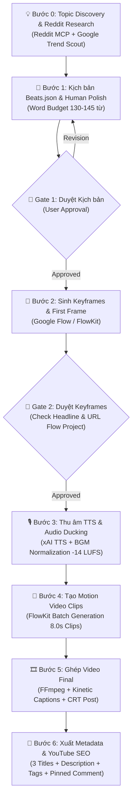

# 🎬 Video Atlas — AI YouTube Automation & Production Pipeline

[English](README.md) | [Tiếng Việt](README.vi.md)

[](https://www.python.org/)
[](https://opensource.org/licenses/MIT)
[](#)
[%20%7C%20Long--form%20(16:9)-red)](#)

> **Video Atlas** là hệ thống pipeline tự động hóa sản xuất video YouTube chất lượng cao đa kênh (Multi-Channel Faceless YouTube Network) nhắm tới thị trường Mỹ (US) và toàn cầu. Hệ thống tích hợp AI Agent, Google Flow (FlowKit Bridge), xAI TTS, và FFmpeg để biến một chủ đề thô thành video hoàn chỉnh từ kịch bản, hình ảnh, chuyển động, giọng đọc, phụ đề kinetic cho đến siêu dữ liệu YouTube SEO.

---

## 📑 Mục lục
- [🌟 Điểm nổi bật](#-điểm-nổi-bật)
- [🏛️ Kiến trúc 4 Kênh Thương hiệu (Brand Identities)](#️-kiến-trúc-4-kênh-thương-hiệu-brand-identities)
- [⚙️ Quy trình sản xuất 6 bước (Pipeline Workflow)](#️-quy-trình-sản-xuất-6-bước-pipeline-workflow)
- [📂 Cấu trúc dự án (Directory Structure)](#-cấu-trúc-dự-án-directory-structure)
- [🚀 Hướng dẫn cài đặt & Thiết lập (Setup Guide)](#-hướng-dẫn-cài-đặt--thiết-lập-setup-guide)
- [🛠️ Hướng dẫn vận hành Pipeline (Quickstart)](#️-hướng-dẫn-vận-hành-pipeline-quickstart)
- [🛡️ Luật sản xuất & Kiểm soát chất lượng (Golden Rules)](#️-luật-sản-xuất--kiểm-soát-chất-lượng-golden-rules)
- [📊 YouTube SEO & Phân phối (Distribution Strategy)](#-youtube-seo--phân-phối-distribution-strategy)

---

## 🌟 Điểm nổi bật

- **Kiểm soát chất lượng bằng 2 cổng kiểm duyệt (2 Approval Gates):**
  - **Gate 1:** Kiểm duyệt kịch bản `beats.json` (Narration tiếng Anh Mỹ tự nhiên, word budget 130-145 từ, không AI-slop).
  - **Gate 2:** Kiểm duyệt bộ Keyframes, kiểm tra First Frame Headline & xóa watermark trước khi sinh clip.
- **Tối ưu hóa First Frame (Frame 0 Shorts CTR):** Công thức 3 lớp loại bỏ 100% màn hình đen, chèn Headline giật gân trực tiếp vào prompt để frame 0 trở thành thumbnail tự nhiên trên Shorts Feed.
- **Âm thanh chuẩn YouTube (-14 LUFS):** Tự động điều chỉnh kỹ thuật Audio Ducking (nhạc nền giảm -18dB đến -22dB khi có thoại), xuất âm lượng chuẩn hóa không bị thuật toán ép giảm volume.
- **Đa dạng phong cách hình ảnh (Multi-Style Visual Engines):** Cắt dán giấy báo chí (Vox Collage), Pixel Art 16-bit kèm CRT Scanline, Truyện tranh Mỹ cổ điển thập niên 80 (Retro Pulp Comic), và Bản vẽ kỹ thuật 3D X-Ray (Blueprint Noir).
- **Google Flow Engine Bridge (FlowKit):** Kết nối trực tiếp trình duyệt Chrome Extension với Python Local Agent qua WebSocket, tối ưu chi phí sinh video với chất lượng điện ảnh.

---

## 🏛️ Kiến trúc 4 Kênh Thương hiệu (Brand Identities)

Mỗi kênh trong hệ thống sở hữu visual DNA, series đặc trưng và chữ ký Outro cố định:

| Kênh | Phong cách hình ảnh | Series chủ đạo | Ngách nội dung | Giọng đọc & Outro Signature |
| :--- | :--- | :--- | :--- | :--- |
| **Papercut Business** | Vox Papercut Collage (Báo cũ, viền xé, băng dính Scotch) | *Everyday Monopolies* | Bí mật kinh tế ngầm, đế chế độc quyền quanh ta | Giọng `leo` (xAI TTS trầm ấm tài liệu).<br>_CTA: "This is just the surface of corporate secrets. Subscribe to Papercut Business for the full deep dive into everyday monopolies."_ |
| **Pixel Rewind** | 16-bit Pixel Art + CRT Scanlines & Phosphor Glow | *Boot Sequence* | Nguồn gốc công nghệ & lịch sử video game kinh điển | Giọng `leo` / `kai` (Hoài niệm công nghệ).<br>_CTA: "That's just one level of tech history. Subscribe to Pixel Rewind for the full playthrough."_ |
| **Pulp Hypotheses** | Retro 1980s Pulp Comic (Nét mực dày, vệt chấm CMYK Halftone) | *Absurd Timelines* | Thí nghiệm tư duy giả định phi lý ("What If" Lịch sử & Khoa học) | Giọng `leo` (Kịch tính, retro comic).<br>_CTA: "That's just one absurd timeline. Subscribe to Pulp Hypotheses for more mind-bending What-If files!"_ |
| **Blackprint** | 3D Isometric Cutaway X-Ray (Blueprint Noir `#0B192C`, Cyan `#00F0FF`) | *Deconstructed* | Giải phẫu siêu công trình, kỳ quan cổ đại & vũ khí kỹ thuật | Giọng `leo` (Trầm lạnh, uy quyền kỹ thuật).<br>_CTA: "Every machine has a secret. Subscribe to Blackprint to unlock the next 3D file."_ |

---

## ⚙️ Quy trình sản xuất 6 bước (Pipeline Workflow)



### Chi tiết các bước:
1. **Bước 0 — Khảo sát & Đào ý tưởng:** Quét insight thực tế từ Reddit (Reddit Research MCP) và xu hướng tìm kiếm Mỹ, tìm các góc nhìn trái trực giác hoặc bí mật chưa từng tiết lộ.
2. **Bước 1 — Biên kịch chuẩn nhịp (`beats.json`):** Viết thoại 100% tiếng Anh Mỹ tự nhiên theo cấu trúc 7-8 shots (53-58 giây cho Shorts). Kiểm soát nhịp 6.5 - 7.5s/shot để khớp hoàn hảo với clip 8.0s của Google Flow.
3. **Bước 2 — Sinh Keyframes (`keyframes.py`):** Tạo hình ảnh độ nét cao theo visual DNA của từng kênh. Shot 1a được chèn Headline trực tiếp vào prompt để làm First Frame Shorts Thumbnail.
4. **Bước 3 — Âm thanh (`audio.py`):** Tạo giọng đọc bằng xAI TTS (`leo`), ghép nhạc nền BGM phù hợp phong cách, ducking âm lượng -20dB dưới giọng đọc và cân bằng chuẩn -14 LUFS.
5. **Bước 4 — Sinh Motion Clips (`clips.py`):** Gửi yêu cầu tới Google Flow qua FlowKit với chỉ thị camera chuẩn (Static cho Comic, Pan mượt cho Papercut, CRT Scanline cho Pixel).
6. **Bước 5 — Hậu kỳ & Render (`assemble.py`):** Ghép nối video, render phụ đề kinetic nổi bật, gắn logo watermark kênh, áp bộ lọc CRT (cho Pixel Rewind), xuất file `final.mp4`.
7. **Bước 6 — Tối ưu SEO (`metadata.py`):** Tạo trọn bộ 3 biến thể tiêu đề giật CTR cao, mô tả chuẩn SEO có gắn timestamp/credits, bộ tag 400-480 ký tự, hashtag và bình luận ghim kêu gọi tương tác.

---

## 📂 Cấu trúc dự án (Directory Structure)

```text
video-atlas/
├── .agents/                      # Hệ thống AI Agent Skills & Quy chuẩn
│   ├── rules/                    # Các quy tắc cốt lõi (Always-on Rules)
│   │   ├── channel-identities.md # Bảng nhận diện 4 kênh, CTA, avatar/banner
│   │   ├── video-production.md   # 17 luật sản xuất, kiểm soát nhịp & an toàn
│   │   └── youtube-ai-production.md # Chiến lược YouTube Shorts & Long-form
│   └── skills/                   # Các chuyên gia kỹ năng độc lập
│       ├── channel_factory/      # Nhà máy tạo kênh & style mới
│       ├── human_scriptwriter/   # Kỹ năng viết kịch bản chất người, anti-AI
│       ├── reddit_research/      # Khảo sát insight người thật từ Reddit
│       ├── youtube_seo_writer/   # Viết metadata & tối ưu SEO YouTube
│       ├── vox_papercut_director/# Đạo diễn hình ảnh Papercut Business
│       ├── pixel_retro_director/ # Đạo diễn hình ảnh Pixel Rewind
│       ├── pulp_comic_director/  # Đạo diễn hình ảnh Pulp Hypotheses
│       └── blueprint_noir_director/# Đạo diễn hình ảnh Blackprint
├── assets/                       # Bộ nhận diện kênh (Watermarks, Scanlines, Banners)
├── flowkit_repo/                 # Cầu nối Google Flow Bridge (Extension & Agent Server)
│   ├── agent/                    # Python API Server & SQLite DB
│   └── extension/                # Chrome Extension tự động bắt token & giải captcha
├── scripts/                      # Bộ công cụ thực thi tự động (Execution Tooling)
│   ├── draft.py                  # Khởi tạo kịch bản beats.json ban đầu
│   ├── keyframes.py              # Sinh ảnh keyframes theo nhịp beats
│   ├── audio.py                  # Sinh giọng đọc xAI TTS & ghép nhạc nền BGM
│   ├── clips.py                  # Điều phối sinh video clips trên Google Flow
│   ├── assemble.py               # Render video hoàn chỉnh bằng FFmpeg
│   ├── text_overlay.py           # Render phụ đề kinetic & chữ nghệ thuật
│   ├── metadata.py               # Xuất metadata YouTube SEO hoàn chỉnh
│   ├── thumbnail.py              # Sinh thumbnail riêng cho video Long-form
│   └── set_active_project.py     # Cấu hình active project ID cho FlowKit
├── thongtinkenh.md               # Toàn bộ hướng dẫn setup YouTube Studio & nuôi kênh
├── README.md                     # Bản tài liệu tiếng Anh mặc định
└── README.vi.md                  # Bản tài liệu tiếng Việt
```

---

## 🚀 Hướng dẫn cài đặt & Thiết lập (Setup Guide)

### 1. Yêu cầu hệ thống
- **Hệ điều hành:** Windows 10/11, macOS, hoặc Linux.
- **Python:** 3.10 trở lên.
- **FFmpeg & FFprobe:** Đã cài đặt và có trong PATH hệ thống.
- **Google Chrome:** Để cài đặt FlowKit Chrome Extension.

### 2. Cài đặt môi trường
Clone repository và cài đặt các thư viện cần thiết:

```bash
git clone https://github.com/Tung-ht/workflow-automate-video.git
cd workflow-automate-video

# Tạo virtual environment
python -m venv .venv
# Kích hoạt trên Windows:
.venv\Scripts\activate
# Hoặc trên Linux/macOS:
# source .venv/bin/activate

# Cài đặt dependencies
pip install -r flowkit_repo/requirements.txt
```

### 3. Cấu hình Biến Môi Trường (Environment Variables)
Tạo file `.env` (hoặc set trong shell) với các biến sau:

```bash
# API Key của Atlas Cloud (cho giọng đọc xAI TTS & BGM)
export ATLASCLOUD_API_KEY="your_atlascloud_api_key_here"

# (Tùy chọn) Nếu dùng Suno hoặc Anthropic Vision
export SUNO_API_KEY="your_suno_key"
export ANTHROPIC_API_KEY="your_anthropic_key"
```

### 4. Thiết lập Chrome Extension (FlowKit Bridge)
1. Mở Chrome và truy cập `chrome://extensions/`.
2. Bật chế độ **Developer mode** (Góc trên bên phải).
3. Bấm **Load unpacked** và chọn thư mục `flowkit_repo/extension`.
4. Đăng nhập vào [Google Flow](https://labs.google/fx/tools/flow) trên trình duyệt để Extension tự động đồng bộ session token.

---

## 🛠️ Hướng dẫn vận hành Pipeline (Quickstart)

### Bước 1: Khởi động FlowKit Backend
```bash
python flowkit_repo/agent/run_server.py
```
*(Kiểm tra sức khỏe: `curl http://127.0.0.1:8100/health` trả về `{"extension_connected": true}`)*.

### Bước 2: Tạo dự án & Kịch bản Beats (`beats.json`)
Sử dụng script tạo khung kịch bản hoặc yêu cầu AI Agent viết kịch bản chuẩn hóa:
```bash
python scripts/draft.py out/my_first_short --topic "Why Casio F91W Never Dies" --channel "pixel_rewind"
```
> 🚪 **Approval Gate 1:** Trình bảng Markdown kịch bản cho User review và phê duyệt nội dung.

### Bước 3: Sinh Keyframes & First Frame Thumbnail
```bash
python scripts/keyframes.py out/my_first_short
```
> 🚪 **Approval Gate 2:** Kiểm tra ảnh `kf_1a.jpg` (có headline rõ ràng), kiểm tra xóa watermark và cung cấp URL Project Google Flow đang mở trên trình duyệt.

Cấu hình Project ID Google Flow:
```bash
python scripts/set_active_project.py <PROJECT_ID_HOẶC_URL>
```

### Bước 4: Tạo giọng đọc & Nhạc nền
```bash
python scripts/audio.py out/my_first_short
```

### Bước 5: Sinh Video Clips trên Google Flow
```bash
python scripts/clips.py out/my_first_short
```
*Clip sẽ xuất hiện trên màn hình Canvas của Google Flow để bạn kiểm tra và tải về thư mục `out/my_first_short/clips/`.*

### Bước 6: Render Video Final & Xuất Metadata SEO
```bash
# Ghép video hoàn chỉnh
python scripts/assemble.py out/my_first_short

# Xuất Metadata YouTube SEO
python scripts/metadata.py out/my_first_short
```
Video xuất xưởng sẽ nằm tại: `out/my_first_short/final.mp4`.

---

## 🛡️ Luật sản xuất & Kiểm soát chất lượng (Golden Rules)

1. **Thời lượng chuẩn Shorts:** Giới hạn nghiêm ngặt **53 đến 58 giây** (tối đa 60s). Thoại mỗi shot giới hạn **6.5 - 7.5 giây** (~15-18 từ) để không bao giờ bị đơ/freeze hình với clip 8s của Google Flow.
2. **First Frame Optimization (Frame 0):** Shot 1a bắt buộc chèn Headline in hoa giật gân, kinetic subtitle cất lên ngay `t=0.00s`. **Tuyệt đối cấm mở đầu bằng màn hình đen hoặc fade-in.**
3. **Outro CTA Bất Biến:** Mọi video bắt buộc có shot Outro CTA tĩnh ở cuối với đúng câu chữ signature của kênh.
4. **Chuẩn âm lượng YouTube:** Giọng đọc TTS nổi bật, BGM ducking **-18dB đến -22dB**, tổng thể đạt **-14 LUFS Integrated**.
5. **Prompt An Toàn Google Flow:** Không dùng tên người nổi tiếng hoặc nhãn hiệu bản quyền trong prompt visual (dùng mô tả chung như *"a charismatic tech entrepreneur in a business suit"* thay vì *"Steve Jobs"*).

---

## 📊 YouTube SEO & Phân phối (Distribution Strategy)

- **Chiến lược Phễu Chuyển Đổi:**
  - Sản xuất **Long-form trước (3-5 phút)**, làm **Short sau (45-55s)**.
  - Đăng Long-form vào buổi sáng (8-10h AM EST). Sau 4-24 giờ đăng Short và gắn **Related Video** trỏ về video Long-form để kéo view bền vững.
- **Gói Metadata chuẩn hóa:**
  - **3 Biến thể Tiêu đề:** Câu hỏi tò mò (Mystery/Why), Sự thật ngầm (Hidden Truth), và Bí mật thất bại (Failure/Secret).
  - **Mô tả 3 tầng:** Hook 2 dòng đầu, tóm tắt nội dung kèm bullet points & timestamp, phần tiết lộ AI Disclosure và Hashtags ngách.

---

## 🤝 Đóng góp & Phát triển
Mọi đóng góp, báo lỗi hoặc đề xuất tính năng mới đều được hoan nghênh. Vui lòng mở **Issue** hoặc tạo **Pull Request** trên repository.

*Phát triển bởi đội ngũ Video Atlas — Hệ thống tự động hóa nội dung số thế hệ mới.*
